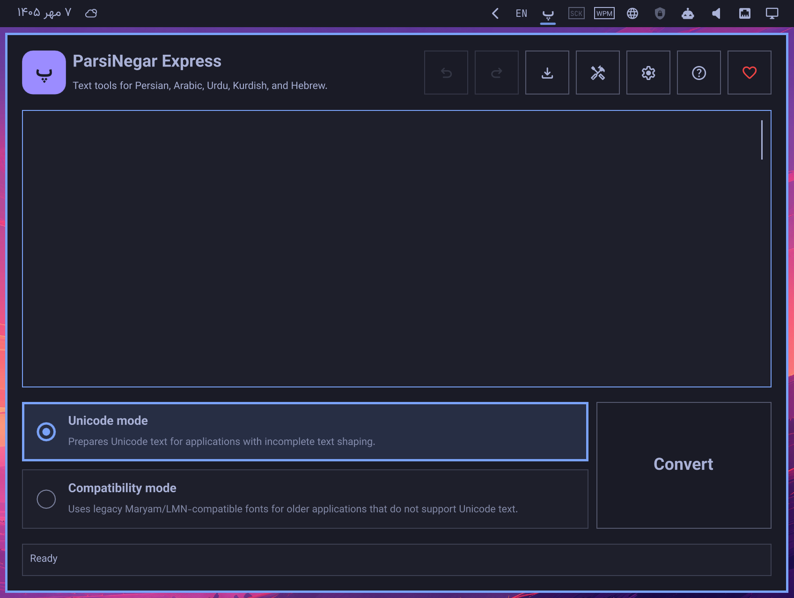
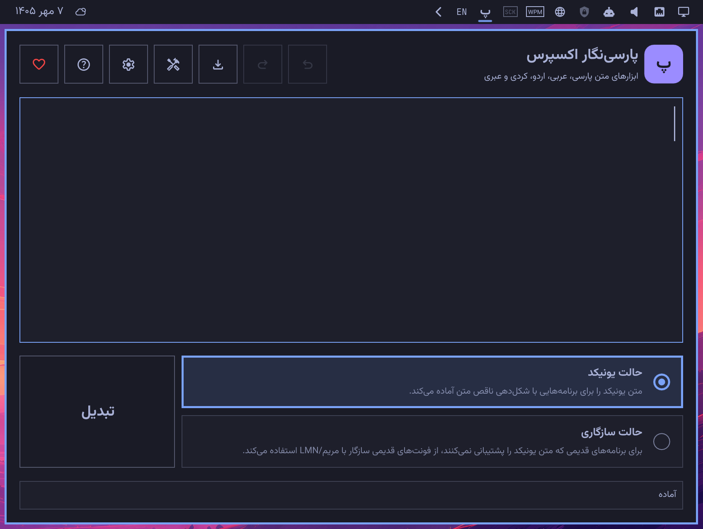
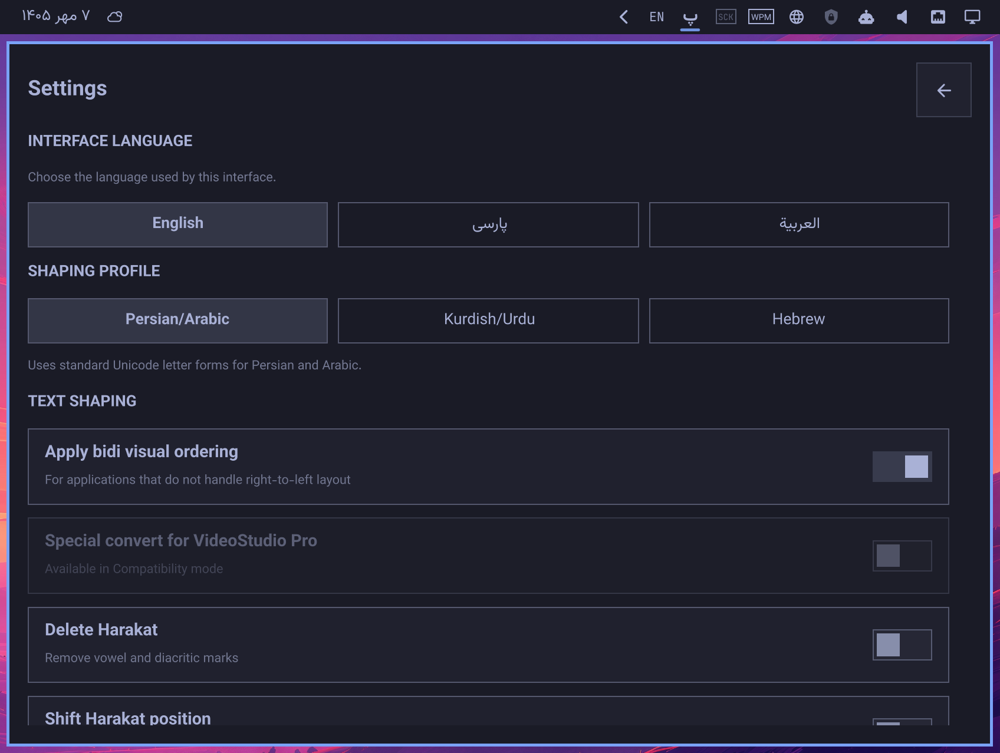

# پارسی‌نگار اکسپرس برای Omarchy

**زبان:** پارسی | [English](README.md)

پارسی‌نگار اکسپرس افزونه‌ای برای پوستهٔ Omarchy 4 از لیومون استودیو است که متن پارسی، عربی، کردی، اردو و عبری را برای برنامه‌هایی با پشتیبانی ناقص از شکل‌دهی نویسه‌ها یا متن دوجهته آماده می‌کند.

## کارکرد افزونه

از **حالت یونیکد** برای برنامه‌هایی استفاده کنید که متن یونیکد را می‌پذیرند، اما شکل‌دهی یا ترتیب متن راست‌به‌چپ را درست انجام نمی‌دهند. افزونه متن را پیش از کپی‌کردن آماده می‌کند و برنامهٔ مقصد همچنان از فونت یونیکد مناسب خودش استفاده می‌کند.

**حالت سازگاری** برای برنامه‌های قدیمی است که متن یونیکد را پشتیبانی نمی‌کنند و به فونت‌های قدیمی سازگار با مریم/LMN نیاز دارند. پس از چسباندن متن، فونت متناظر را در برنامهٔ مقصد انتخاب کنید. این حالت از عبری پشتیبانی نمی‌کند.

نمایهٔ شکل‌دهی **عبری** فقط در حالت یونیکد کار می‌کند. در این نمایه، JsParsiReshaper اجرا نمی‌شود و JsBidi تنها ترتیب نمایشی متن دوجهته را تنظیم می‌کند؛ شکل‌دهی زمینه‌ایِ حروف عربی روی متن عبری اعمال نمی‌شود.

## روش استفاده

روی **پ** در نوار Omarchy کلیک کنید، متن را بنویسید یا جای‌گذاری کنید، نمایهٔ شکل‌دهی و حالت تبدیل را انتخاب کنید و **تبدیل** را بزنید. نتیجه در کلیپ‌بورد کپی می‌شود.

در بالای پنل، فرمان‌های سند، واگرد، بازانجام، خروجی SVG، ابزارهای متن، تنظیمات و راهنما قرار دارند. تا زمانی که پنل بارگذاری شده است، تاریخچهٔ متن ورودی حداکثر ۱۰۰ ویرایش را نگه می‌دارد. صفحهٔ راهنما گزینه‌ها و روش‌های استفاده را به زبان رابط کاربری توضیح می‌دهد.

### جهت متن و ابزارهای متن

گزینهٔ **اعمال ترتیب نمایشی دوجهته** به‌صورت پیش‌فرض روشن است. هر بند جداگانه پردازش می‌شود تا جهت متن‌های ترکیبی پارسی و لاتین حفظ شود. اگر برنامهٔ مقصد خودش متن دوجهته را درست نمایش می‌دهد، این گزینه را خاموش کنید.

جهت هر بند در ویرایشگر از نخستین نویسهٔ دارای جهت مشخص تعیین می‌شود. متن لاتین به چپ و متن پارسی، عربی، اردو، کردی و عبری به راست تراز می‌شود.

**ابزارهای متن** پیش از تبدیل، متن ورودی را بی‌درنگ تغییر می‌دهند. این ابزارها شامل یکدست‌سازی نویسه‌های پارسی، پاک‌سازی متن و شکل‌های جایگزین نویسه‌ها هستند.

### خروجی SVG

با **خروجی SVG** می‌توانید متن تبدیل‌شده را به منحنی‌های برداریِ قابل‌ویرایش با فونت انتخابی تبدیل کنید. حالت یونیکد با فونت وزیرمتنِ همراه افزونه آغاز می‌شود و سبک‌های نام‌گذاری‌شدهٔ فونت‌های متغیرِ نصب‌شده را جداگانه نشان می‌دهد. سبک انتخابی برای رسم منحنی‌های SVG استفاده می‌شود. برای خروجی در حالت سازگاری باید یک فونت سازگار با مریم انتخاب کنید. خروجی‌گیر نویسه‌های بدون نقش را گزارش می‌کند و می‌تواند هشدارها را جدا از وضعیت تبدیل متن در ویرایشگر نشان دهد.

خروجی SVG فونت‌های TrueType و OpenType/CFF تا اندازهٔ ۵ مگابایت را می‌پذیرد. پیش از اجرای نسخهٔ همراه و دست‌نخوردهٔ Typr.js، فایل `SafeTypr.js` خود افزونه فهرست جدول‌های فونت، جابه‌جایی‌های CFF INDEX، تعداد گروه‌های cmap قالب ۱۲ و محدودهٔ خواندن بایت‌ها را بررسی می‌کند. فونت ناسالم با خطای `INVALID_FONT` رد می‌شود و فایل SVG ذخیره نمی‌شود. این بررسی‌ها برای جلوگیری از خواندن یا تخصیص حافظهٔ خارج از محدوده یا بیش‌ازحد بزرگ طراحی شده‌اند، اما اعتبارسنجی کامل قالب فونت نیستند و جای استفاده از فونت‌های مورداعتماد را نمی‌گیرند.

### تنظیمات و حریم خصوصی

در **تنظیمات** می‌توانید زبان رابط کاربری، نمایهٔ شکل‌دهی، گزینه‌های شکل‌دهی و لیگچرهای نام‌گذاری‌شدهٔ مرتبط و اندازهٔ پایدار متن ویرایشگر را تغییر دهید. برای تغییر اندازهٔ متن از ۱۰ تا ۴۸ پیکسل، `Ctrl` را نگه دارید و روی ویرایشگر چرخ ماوس را بچرخانید.

افزونه این تنظیمات را در `~/.config/leomoon-studios.omarchy-parsinegar-express/settings.json` ذخیره می‌کند. پیش‌نویس‌ها، متن تبدیل‌شده، محتوای کلیپ‌بورد و تاریخچهٔ واگرد ذخیره نمی‌شوند. رابط کاربری از وزیرمتنِ همراه افزونه استفاده می‌کند و نیازی به نصب جداگانهٔ فونت رابط نیست.

## میانبرهای صفحه‌کلید

- `Ctrl+Enter`: تبدیل
- `Ctrl+,`: نمایش یا پنهان‌کردن تنظیمات
- `Ctrl+T`: نمایش یا پنهان‌کردن ابزارهای متن
- `Ctrl+E`: نمایش یا پنهان‌کردن بخش خروجی
- `Ctrl+H`: نمایش یا پنهان‌کردن راهنما
- `Ctrl+wheel`: تغییر اندازهٔ متن ویرایشگر

## پیش‌نمایش

**پارسی‌نگار اکسپرس به زبان انگلیسی**



**پارسی‌نگار اکسپرس به زبان پارسی**



**تنظیمات**



## امکانات

- شکل‌دهی زمینه‌ای متن پارسی و مرتب‌سازی دوجهته برای برنامه‌هایی با پشتیبانی ناقص از متن راست‌به‌چپ
- حالت یونیکد برای فونت‌های استانداردِ پشتیبان پارسی
- پشتیبانی از عبری در حالت یونیکد با ترتیب نمایشی دوجهته، بدون شکل‌دهی زمینه‌ای
- حالت سازگاری برای برنامه‌های قدیمی با فونت‌های سازگار با مریم
- تبدیل و کپی نتیجه در کلیپ‌بورد با یک کلیک
- واگرد و بازانجام متن ورودی تا ۱۰۰ ویرایش، همراه با حفظ مکان نشانگر، انتخاب و بندها
- کنترل جهت راست‌به‌چپ و چپ‌به‌راست ورودی، ترتیب نمایشی دوجهتهٔ اختیاری و تبدیل VideoStudio Pro
- نمایه‌های شکل‌دهی پارسی/عربی و کردی/اردو و نمایهٔ ویژهٔ عبری
- تنظیم اعراب، کشیده، ZWJ و لیگچرهای نام‌گذاری‌شده، از جمله نشان ریال، برای نمایه‌های مرتبط
- خروجی منحنی‌های SVG با فونت انتخابی در حالت یونیکد یا سازگاری و هشدار نویسه‌های بدون نقش
- رابط کاربری پارسی، انگلیسی و عربی با تنظیمات پایدار
- بارگذاری پردازش‌های پس‌زمینه فقط هنگام نیاز، بدون فعالیت هنگام بسته‌بودن منو

## نصب

برای نصب از گیت‌هاب:

```sh
omarchy plugin add https://github.com/leomoon-studios/omarchy-parsinegar-express --enable
```

افزونه به‌صورت پیش‌فرض در سمت راست نوار قرار می‌گیرد. وزیرمتن نسخهٔ 33.003 برای رابط کاربری، JsBidi برای ترتیب دوجهته و JsParsiReshaper برای شکل‌دهی زمینه‌ای همراه افزونه هستند؛ بنابراین بدون اینترنت و بدون نصب وزیرمتن در سیستم یا بسته‌های جاوااسکریپت کار می‌کند. برای مجوزها و پیوندهای منبع، [THIRD_PARTY_NOTICES.md](THIRD_PARTY_NOTICES.md) و برای رابط برنامه‌نویسی و گزینه‌های شکل‌دهی، به‌ترتیب [JsBidi](https://github.com/leomoon-studios/js-bidi) و [JsParsiReshaper](https://github.com/leomoon-studios/js-parsi-reshaper) را ببینید.

## حذف

```sh
omarchy plugin remove leomoon-studios.omarchy-parsinegar-express
rm -rf ~/.config/leomoon-studios.omarchy-parsinegar-express
```

دستور دوم اختیاری است و تنظیمات ذخیره‌شدهٔ افزونه را برای همیشه پاک می‌کند.

## سازگاری

این افزونه فقط از Omarchy نسخهٔ 4.0 یا جدیدتر در محیط Wayland پشتیبانی می‌کند.
